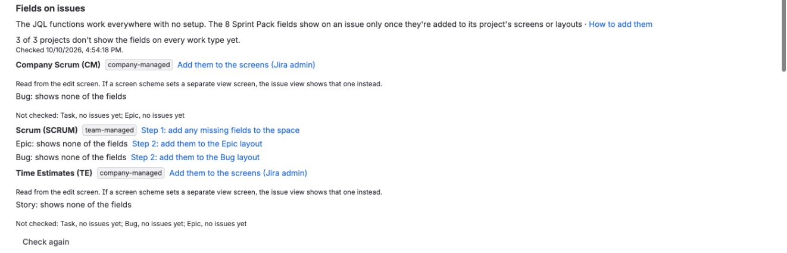
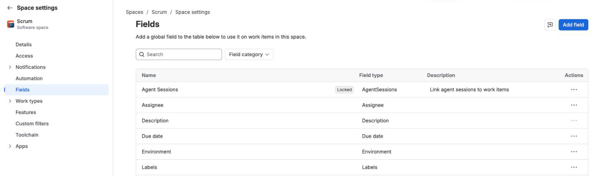
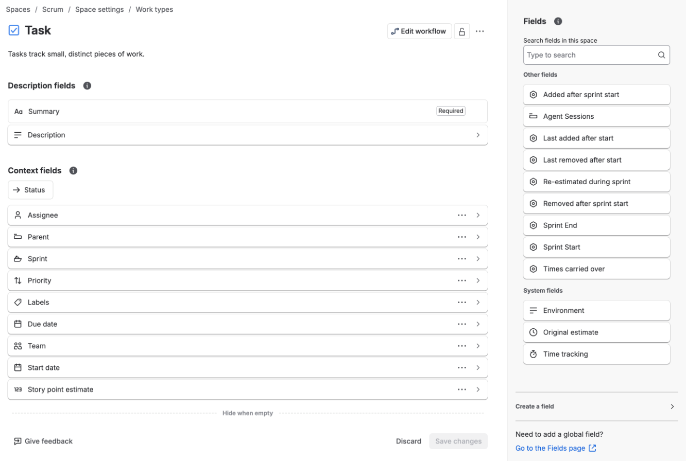
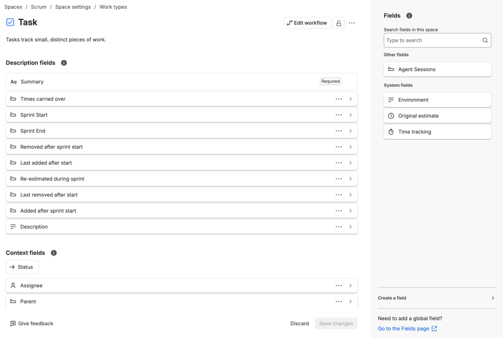
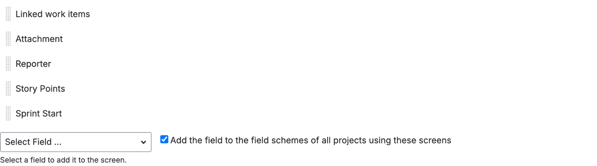

<!-- Status: written 2026-10-08 (clarity pass C1, C6; the license section, checklist 1.1; fields on issues, checklist 1.2; dismissing an inferred reopen, approved 2026-10-09). -->

# Admin page

**Jira settings → Apps → Sprint Pack.** For Jira admins. Top to bottom: the [license](#license) when it needs a word, [getting started](#first-steps) during the trial, what needs attention, [fields on issues](#fields-not-showing), health, the hourly budget, rebuilds, and BI data.

## Getting started (during the trial)

While the trial runs, the top of the admin page lists three steps to see Sprint Pack working on your site:

1. **Open a board's Sprint scope page and look at its last closed sprint.** The page links to a board whose last closed sprint is already computed. If none is yet, it says how long the history scan has left. This step ticks itself once anyone sees a closed sprint's figures on the Sprint scope page or in the sprint menu.
2. **Add the Sprint scope widget to a dashboard.** See [dashboard widget](views.md#widget). This step ticks itself once a dashboard shows a board's figures.
3. **Send the [request kit](request-kit.md#request-kit) to whoever approves apps on your site.** It covers the cost, the security answers and what changes in Jira. Sprint Pack can't tell when you've sent it, so tick it with **Mark as sent**.

The steps are for the whole site, not per admin. Once the trial ends the section goes away.

## Needs attention

**One line per problem. When nothing needs attention, the section is hidden.**

| Item | What it means | What to do |
|---|---|---|
| [Failed JQL searches](#failed-searches) | Saved searches using Sprint Pack's functions that hold an error | Grouped by fix; retry, rebuild or fix the query |
| [History scan](#history-scan-skipped) | The backfill scan skipped a board, couldn't rebuild some issues, or stopped making progress | Fix the board's filter, or **Run backfill now** |
| [Left out of site-wide searches](jql.md#site-wide-skips) | Boards that searches with no board argument skipped: a sprint still computing, or settings Sprint Pack can't read | Wait for computing (rebuild if stuck); share the board's filter for unreadable settings |
| Fields with the same name as Sprint Pack's | Another field on the site (from another app, or a custom field) has the name of one of Sprint Pack's fields. JQL finds the sprint-list fields by name, so their searches can fail or match the wrong field | Rename the other field in Jira settings → Work items → Fields |
| Sprints stuck | Sprints that should be computing (active, the last 6 closed per board, or ones someone asked about) where nothing has moved for over 2 hours while the hourly budget had room, longest stuck first. Sprints held up by the budget aren't listed: Health counts them as waiting for the hourly budget, and they carry on when the hour turns | **Rebuild** each one. If it stays stuck, **Run backfill now**. See [computing](numbers.md#computing) |
| Boards with unreadable settings | Sprint Pack can't read the board's columns, so nothing counts as completed | Share the board's filter. See [settings unreadable](numbers.md#settings-unreadable) |
| Boards Sprint Pack can't see | Boards with recent sprints (active, future, or closed in the last 90 days) that Jira doesn't show to the app, usually because the board's filter isn't shared with it. Searches with no board argument and the portfolio leave them out | Share the board's filter, then **Check again**. See [settings unreadable](numbers.md#settings-unreadable) |
| [Closed sprints with no close date](#closed-without-date) | Left out of every view | Check them in Jira |
| Sprints with anomaly flags | Bad data, left out of averages | Open the sprint; fix the data where Jira allows. See [anomalies](anomalies.md) |
| BI requests | People asked for a board's BI data | Publish or dismiss. See [requests](bi.md#requests) |
| BI credential expiry | A reader's API token expires within 30 days | Create a new token before then. See [service account](bi.md#service-account) |

### Failed JQL searches

**Jira stores the result of every saved search that uses a Sprint Pack function. When a result is an error, it stays an error until it's re-evaluated.** The admin page lists them grouped by what fixes them, one line per distinct message, with up to three of the searches as written and how many searches hit it.

| Group | Cause | Fix |
|---|---|---|
| **Searches blocked while the license isn't active** | The [license](#license) isn't active | Renew it; these clear within the hour. Retrying before then gives the same error. |
| **Waiting for Jira to make the fields searchable** | Jira's search doesn't know the new fields yet, a few minutes after install | Nothing: these clear by themselves once it does. While it lasts, a notice at the top of the admin page names the fields Jira can't search yet. |
| **Waiting for sprints to be indexed** | The sprint wasn't computed when the search ran | These clear by themselves once the sprints finish computing. If one is stuck, **Rebuild sprint N** (a button per sprint). |
| **Board settings Sprint Pack can't read** | The board's filter isn't shared with the app | Share the board's filter with its project, or with a group that includes the app. |
| **Searches that name something that doesn't exist** | A wrong sprint or board name, an ambiguous name, a bad date or field | Whoever saved the search (a filter, board or gadget) needs to change the arguments. The line shows the function and its arguments. |
| **Searches Sprint Pack couldn't evaluate** | A temporary failure | The hourly sweep retries these; **Retry failed searches** tries again straight away. |
| **Other errors** | Anything else | Retry; if they come back, the message says what went wrong. |

**Retry failed searches** re-evaluates every stored search that holds an error, within a minute or two. Every message and its fix is also listed in [search errors](jql.md#search-errors).

People using a failed search through the REST API (a gadget, a script) see an empty result, not the message, so it's worth clearing these.

## Health

In plain sentences:

- **Installed** on, and how many **boards** Sprint Pack knows.
- **Sprints:** how many are up to date; how many are [computing](numbers.md#computing) or queued (in the history scan, after it, or waiting for it after an update changed the counting rules); how many older ones will be computed when someone first views them (these never need attention); how many are waiting for the hourly [budget](#budget) (they carry on when the hour turns); and how many are stuck. And how many searches are waiting on them.
- **On sites with more than 3,000 sprints,** the sprint counts and the lists under "Needs attention" are gathered in the background, and the page says when they're from. They're refreshed when they're over 15 minutes old, or when you press **Refresh**. The history scan's problems are always current.
- **Stored JQL results,** and how many hold errors (see [failed searches](#failed-searches)).
- **Last sweep:** when the hourly sweep last ran, and what it did (sprints rebuilt, errors refreshed, BI copies requeued), with its last error if any.
- **Backfill:** when it ran and what's in progress. See [backfill](#backfill).
- **Freshness:** see [below](#freshness-admin).
- **Inferred reopens:** see [below](#inferred-reopens).

### Freshness

**"Fields update a median of 12 s after a sprint change"**, with the 90th percentile and the worst case over the most recent changes Sprint Pack has measured.

- Measured from the sprint change to Sprint Pack's fields being written. JQL sees the write about a second later.
- Sprint Pack waits 10 seconds to write a burst of changes together.
- A worst case of minutes usually means Jira delivered its events late. The hourly sweep catches anything missed. A sprint start Sprint Pack never heard about can take a few hours to be picked up on sites with more than 50 boards.
- See [how fresh the fields are](jql.md#freshness).

### Inferred reopens

**Reopens (and closes) that happened before Sprint Pack was installed, worked out from the issues' sprint history.**

Sprint Pack looks for the signature in the issues' history: many issues gaining a later sprint at one moment (the close), then many losing this sprint at another (the reopen). Each one is listed, with the time and how many issues showed the pattern, for you to check against Jira's Sprint Report.

Sprints with a reopen, observed or inferred, carry the [reopened](anomalies.md#reopened) flag.

**If the Sprint Report shows no reopen,** choose **Not a reopen** beside it. The flag clears and the sprint is rebuilt, so issues that left the sprint at that time count as removed again. Who dismissed it and when stay listed, and **Restore** undoes it. Sprint Pack doesn't infer a dismissed reopen again.

Board admins see their own board's inferred reopens, with the same buttons, in the board panel on the Sprint scope page. See [the board panel](views.md#project-page).

## Budget

**Sprint Pack limits how much it reads from Jira each hour.** Every read costs points; the table shows, for each kind of work, the points used this hour and its cap.

| Kind of work | Cap per hour |
|---|---|
| Live events (issue and sprint changes as they happen) | No cap |
| Reconciliation (recounting a sprint at its close, retrying searches) | No cap |
| Evaluating JQL functions | No cap |
| BI rollups (writing published data) | No cap |
| Hourly sweep | 2,000 |
| Backfill and on-demand computing (one shared pool) | 1,000, plus whatever the sweep didn't use this hour |
| Views and exports (people looking at Sprint Pack) | 5,000 |

- **On-demand computing** (a view or a search waiting for a sprint) **shares backfill's pool**.
- **When a cap is reached:**
  - **Sweep:** checks its cap before each page of issues it rebuilds and stops there; the next hour's sweep carries on from where it stopped.
  - **Backfill and on-demand:** the work waits for the next hour and carries on by itself. Sprints show "computing" a little longer.
  - **Views and exports:** views say "Sprint Pack has used its hourly budget for views on this site. Try again after the top of the hour." Exports keep the Sprints table complete and stop the issue tables with a message (see [large exports](exports.md#export-budget)).
- Accounting is approximate: each check counts what's been spent this hour, including the run that's checking. Caps can be changed without an update.

## Rebuild a sprint

**Rebuild recomputes one sprint from Jira's history.** Pick a board, then a sprint (or type a sprint ID).

- Use it for a sprint that stays "computing" or "indexing", or whose numbers look wrong after a change in Jira.
- The sprint shows "computing" until it's done, usually within minutes. Views refresh themselves, and saved searches waiting on it are updated.
- It runs in the [backfill and on-demand pool](#budget).
- **A future sprint** has nothing to compute yet. Rebuilding one rewrites its issues' Sprint Start and End, which show its planned dates. Changing a future sprint's dates in Jira does this by itself.
- It's safe to run more than once.

## Backfill

**At install, Sprint Pack computes each board's active sprints and its last 6 closed sprints from history.** Older sprints are computed the first time someone asks about them (in a view or a search).

- **One scan for the whole site.** It reads each issue once, newest first, and a sprint is ready as soon as the scan has passed its start date: active sprints first, then the most recent closed ones on every board.
- **How long:** it runs in the [backfill and on-demand pool](#budget). When the hour's pool is used up it stops, even part-way through a run, and carries on at the top of the next hour, so on a large site it takes days rather than hours. Health shows how far back history is complete, how many sprints are computed, and about how long is left, estimated from the scan's speed so far (waiting hours included).
- **Sprints someone opens come first.** 300 points of each hour's pool are kept for them. A sprint the scan will reach within the hour waits for it instead.
- **Sprints that started more than 180 days ago** are computed one at a time once the scan finishes.
- **Run backfill now** queues the same work again for any of those sprints that aren't up to date: useful after adding many boards. A scan already running keeps going.
- After an update that changes the counting rules, the scan runs again by itself.
- After install, no backfill is needed: changes are recorded as they happen.

### When the history scan has a problem

The admin page lists these under "Needs attention", under **History scan**:

- **A board was skipped.** The scan reads each board's issues through the board's filter. If that search fails 3 times, 5 minutes apart, the scan skips the board so the other boards finish, and computes the board's sprints one at a time instead. The usual causes are a filter Sprint Pack can't read, or a filter whose JQL Jira now rejects (a deleted field, project or status). The error from Jira is shown next to the board. Share the filter with the app (or with a group that includes it), or fix its JQL in Jira, then press **Run backfill now**.
- **Issues couldn't be rebuilt.** When Jira returns an error for an issue's history, the scan carries on without it and computes that issue's sprints again when it ends. If one of them then shows as stuck, [rebuild](#rebuild) it.
- **No progress for over 2 hours.** Not counted while the scan is waiting for the hourly [budget](#budget): the health line then says so, and the scan carries on when the hour turns. Otherwise the scan's next run was probably lost. **Run backfill now** starts it again from where it stopped. The health line shows when it last made progress.

## Fields not showing on issues

**The JQL functions need no setup: they work in every project as soon as Sprint Pack is installed.** The 8 fields are different. They appear on an issue only once they're added to its project's layout (team-managed) or screens (company-managed). Until then Sprint Pack still writes them and JQL searches on them still work, but nobody sees them on the issue.

**The admin page checks this for you.** For company-managed projects it reads the screen used to edit issues, which is the same screen unless the scheme sets a separate view screen; if yours does, check the view screen yourself. Under **Fields on issues**, it lists each project the boards use whose work types don't show all 8 fields, with links to the pages below. **Check again** re-runs the check after you've changed something; on a large site it can take a minute. Right after install the check waits until Jira's search knows the fields, since Jira doesn't list them anywhere before then. Sub-tasks aren't checked. A work type it couldn't check is listed under the projects with nothing to do, with the reason: no issues yet, only closed issues, or no access to the project or its screen.

### Team-managed projects (spaces): two steps

A space admin can do both steps.

1. **Add the fields to the space.** Open Space settings → **Fields**, then **Add field**. Search for and tick all 8: Sprint Start, Sprint End, Added after sprint start, Removed after sprint start, Last added after start, Last removed after start, Times carried over, Re-estimated during sprint. The search matches names, so try "sprint", "after start" and "carried". Then click **Add 8 fields**.

   

2. **Add them to each work type's layout.** Open Space settings → **Work types** → a type (Story, Task, Bug, Epic…). The 8 fields are listed on the right under *Other fields*. Click each one to add it to the layout, or drag it to where you want it. Then click **Save changes**. Repeat for every work type your sprints use.

   

   

Step 2 is the one people miss. A field that's only in the space shows on no work type, and the layout's panel lists only fields already in the space, so do step 1 first.

### Company-managed projects: the screens

This needs a Jira admin.

1. Open the project's Project settings → **Screens**. Each screen scheme lists the work types that use it.
2. Expand a scheme and open the screen used to **view** issues. Most schemes have only a default screen, which is then the one. The issue view shows the fields on the view screen, so a field only on the edit screen doesn't show.
3. At the bottom, choose each Sprint Pack field from **Select Field** to add it.
4. Repeat for every scheme whose work types your sprints use.

If a screen is **shared by** other projects, the fields appear there too. They're read-only and stay empty on issues that were never in a sprint, so this is usually harmless.

The fields are read-only: Sprint Pack writes them, and nobody can edit them. See [the fields](jql.md#fields).

## Closed sprints with no close date

**Jira occasionally has a closed sprint with no close date. Sprint Pack can't place it in time, so no view, chart or export shows it.** The admin page lists such sprints.

- They're never matched by `"previous"` or `"last N"` in the JQL functions either.
- Nothing in Sprint Pack fixes them; check the sprint in Jira.

## License

**While the license is active or in its trial, everything works. If it lapses, Sprint Pack stops showing results but keeps recording sprint changes for 90 days, so renewing in that time leaves no gap.** Atlassian keeps a license active through the payment window and the paid period after a cancellation, so this only starts once Atlassian marks the license inactive.

| | License inactive, under 90 days | Inactive for 90 days or more |
|---|---|---|
| **Recording sprint changes** | Continues | Stops |
| **JQL functions** | Return an error saying the license isn't active, including saved filters and board quick filters that use them | The same |
| **Views** (project page, sprint menu, gadget, widget, portfolio) | A notice in place of the figures | The same |
| **Issue fields** | Not updated | Not updated |
| **Published BI data** | Kept as it was, with a notice in `notices`; not refreshed and not deleted | The same |
| **Backfill and rebuilds** | Wait for renewal | Wait for renewal |
| **This page** | Works, and shows the date recording stops | Works, and shows the date recording stopped |

Nothing Sprint Pack recorded is deleted. To remove published BI data, use **Unpublish all** under [BI data](bi.md#publishing).

**On renewal** everything comes back within the hour, or at once when someone next opens a view or runs a search: searches are evaluated again, fields are rewritten for the issues that changed meanwhile, and published BI data is refreshed. After 90 days or more, Sprint Pack also catches up on the time it wasn't recording, as it does at install: every sprint that was active or closed in that time is recomputed from Jira's history (they show "computing" until then), and the issues that changed are rewritten. Older sprints keep the numbers computed before. Sprints that closed in that time are [approximate](numbers.md#approximate) for completion, like sprints from before install.

A board whose own filter uses a Sprint Pack function may not load while the license is inactive.

## BI data

The BI section (turning BI data on, publishing boards, labels, the reader credential's expiry, the setup and the handoff for your BI team) is described in [BI tools](bi.md).
